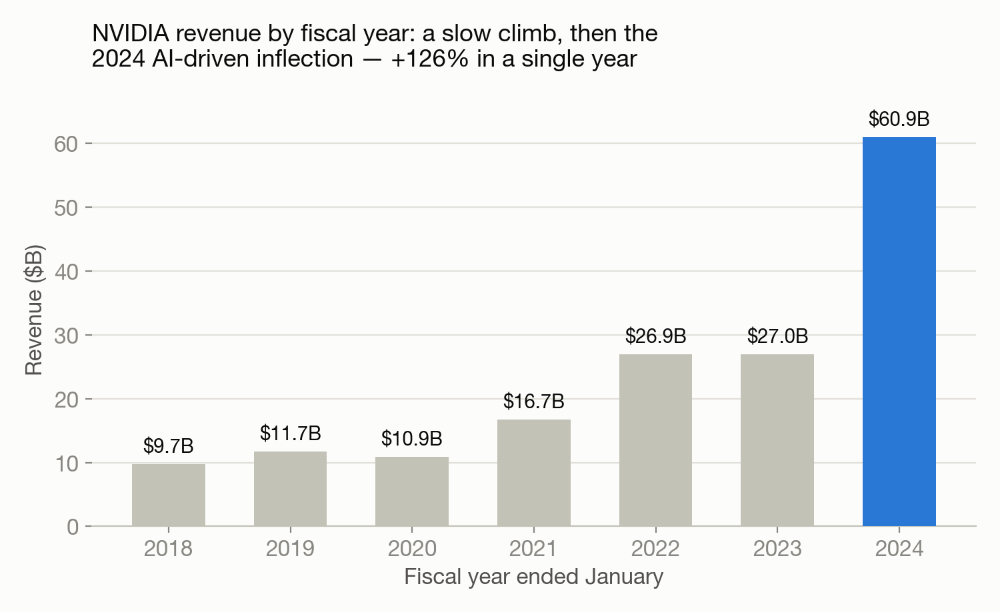

# NVIDIA Equity Research (CFA Challenge Format)

A full sell-side-style equity research report and valuation model on **NVIDIA Corporation**, written to the CFA Research Challenge format, with a buy/sell recommendation backed by a financial model.

Team project for **FIN-B Equity Investment Research (CFA Challenge)** at Hult International Business School.

---

## The problem

Take the role of a research analyst: cover a listed company end to end — business, industry, financials, valuation, and risks — and issue a defensible investment recommendation supported by a built-out Excel model.

## The approach

- **Report structure (CFA format):** executive summary, business overview with ESG/DEIB, economy & industry overview and competitive positioning, financial analysis, investment summary & valuation, and investment risks.
- **Industry analysis:** the AI/semiconductor market, NVIDIA's >80% global GPU share, and data-center revenue concentration.
- **Valuation:** a financial model producing an implied price under multiple scenarios, with forecasted volatility.

## Results

| Output | Value |
|---|---|
| Recommendation | **Buy** |
| Implied price (optimistic) | $193.95 |
| Upside | ~43% |
| 10-year total return | ~90.44% |
| FY2024 revenue | $60.92B (+126% YoY) |
| FY2024 net income | $29.76B |

## Deliverables

- [`nvidia_equity_research_report.docx`](nvidia_equity_research_report.docx) — the full research report.
- [`nvidia_equity_research_presentation.pptx`](nvidia_equity_research_presentation.pptx) — the pitch deck.
- [`nvidia_valuation_model.xlsx`](nvidia_valuation_model.xlsx) — the valuation / financial model.

## Stack

- Excel (financial modeling, scenario valuation)
- Equity research and CFA Challenge reporting framework
